<!-- Animated Header Banner -->

<!-- Typing SVG -->

<!-- Social Badges -->

 

<!-- Clickable jump menu -->

## About Me

  

 

| 🎓 Education | 🧠 Expertise | 💬 Languages |
|:---:|:---:|:---:|
| MSc AI @ Heriot-Watt BSc CS @ Symbiosis (CGPA 8.1) | Computer Vision · RAG Deep Learning · NLP | Python · C++ · SQL JavaScript · TypeScript · Dart |

<b>🎁 Click for a fun fact</b>

 

I published a full-length book on **Flutter App Development** 📘 and I also run a design & branding studio, [Aperture Digital Media](https://aperturedigitalmedia.online) 🎨.

---

## Tech Stack

 

<b>🤖 AI &amp; Machine Learning</b>

 

<b>☁️ Cloud, Databases &amp; DevOps</b>

 

<b>🛠️ Languages &amp; Dev Tools</b>

 

---

## Experience

<b>🏢 VirtueCloud — Lead AI Developer &amp; PM</b> &nbsp;·&nbsp; <I>April 2023 – Present · India/Dubai</i>

 

- 🤖 Built a conversational AI Concierge using **AWS Bedrock** + custom **RAG pipeline** → **99% accuracy** in automating guest services
- ⚙️ Managed CI/CD deployment pipelines on **AWS EC2** with **Redis-first caching**
- 🏗️ Architected multi-tenant **SaaS platform** with PostgreSQL **Row-Level Security** for enterprise data isolation

<b>🏢 TCS — AI Developer (Computer Vision)</b> &nbsp;·&nbsp; <i>June 2022 – January 2023 · Indore, India</i>

 

- ✍️ Engineered handwriting detection CV model using **Python + TensorFlow** → **99% accuracy**
- 🔁 Implemented **self-learning capabilities** with continuous retraining on user samples
- 📈 Integrated model into cross-platform app, boosting task accuracy by **30%**

---

## Projects

<table>
  <tr>
    <td align="center" width="50%" valign="top">
      <h3>🌾 Crop Disease Prediction</h3>
      
      
      
Deep learning model that diagnoses crop diseases from image + soil data. CNN built from scratch with learning rate scheduling and dropout, deployed via a Python backend.

    </td>
    <td align="center" width="50%" valign="top">
      <h3>🤖 AI Concierge (RAG System)</h3>
      
      
      
Conversational AI automating hotel guest services &amp; ticketing with 99% accuracy. Custom RAG architecture on AWS Bedrock with Redis caching for ultra-low latency.

    </td>
  </tr>
  <tr>
    <td align="center" width="50%" valign="top">
      <h3>📦 Inventory Management App</h3>
      
      
      
Cross-platform app tracking production output and managing 10,000+ SKUs with real-time database sync. Deployed for Hyginiee &amp; other clients.

    </td>
    <td align="center" width="50%" valign="top">
      <h3>✍️ Handwriting Recognition (TCS)</h3>
      
      
      
CV model for handwriting-to-text conversion with self-learning capabilities. Research published in the Journal of Maharaja Sayajirao University of Baroda.

    </td>
  </tr>
</table>

### 📌 Pinned repos (auto-updating)

> 💡 Swap `repo=avnishr13` for any of your repo names, and duplicate the line to pin more.

---

## GitHub Stats

<b>🏅 Open the trophy cabinet</b>

 

<b>📈 Contribution heatmap</b>

 

---

## 🐍 Snake eating my contributions!

> A snake is munching through my GitHub contribution graph. Every commit is a snack! 🎮

<picture>
  <source media="(prefers-color-scheme: dark)" srcset="https://raw.githubusercontent.com/avnishr13/avnishr13/output/github-contribution-grid-snake-dark.svg" />
  <source media="(prefers-color-scheme: light)" srcset="https://raw.githubusercontent.com/avnishr13/avnishr13/output/github-contribution-grid-snake.svg" />
  
</picture>

---

## Achievements & Publications

| 🏅 Achievement | 📄 Details |
|---|---|
| 📰 **Research Paper** | *"Recognition of Handwritten Characters"*, Journal of Maharaja Sayajirao University of Baroda |
| 📘 **Published Book** | *"Application Development using Flutter"*, full-length authored book |
| 🎓 **IBM Certification** | Data Analytics Professional Certificate, Coursera |
| 🎨 **Google Certification** | Foundations of UX Design |
| 🎯 **99% Accuracy** | AI models deployed at both TCS and VirtueCloud |

---

## Education

<b>🏛️ Heriot-Watt University, Dubai</b> &nbsp;·&nbsp; <i>2025 – 2026</i>

 

Master of Artificial Intelligence

<b>🏛️ Symbiosis University of Applied Sciences, Indore</b> &nbsp;·&nbsp; <i>2019 – 2023</i>

 

Bachelor of Computer Science & IT · CGPA: **8.1 / 10**

---

## Let's Connect

> *"AI isn't just about building smarter systems. It's about building systems that make the world smarter."*

 

 

 

<!-- Footer Wave -->

